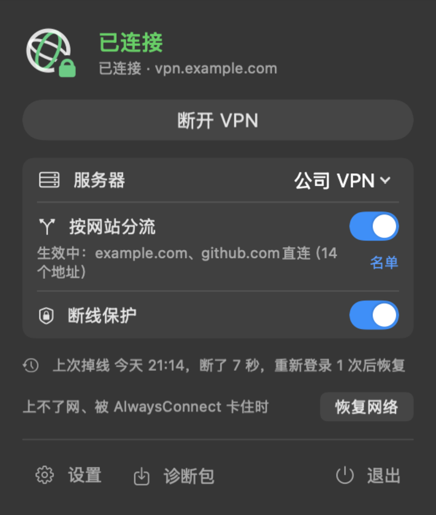
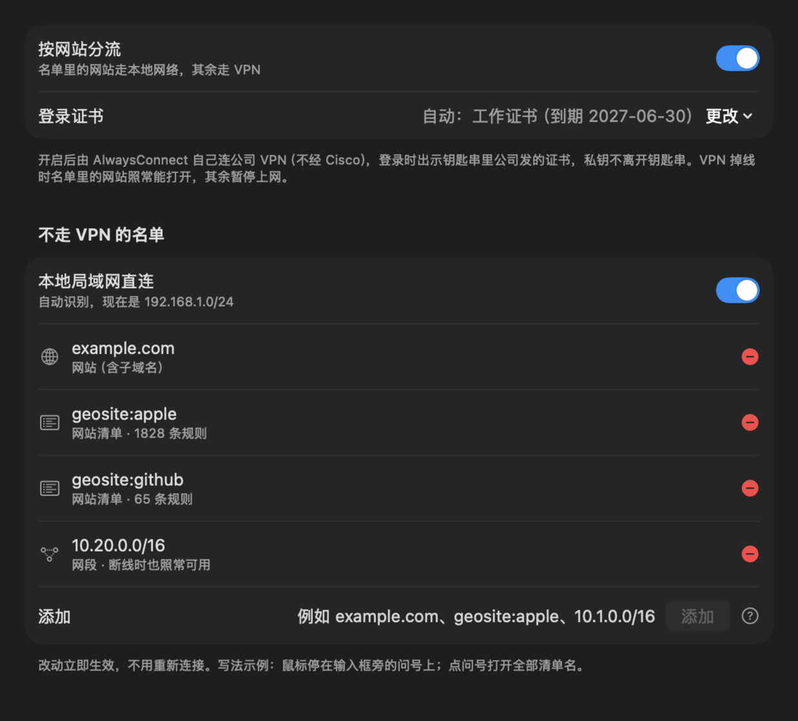
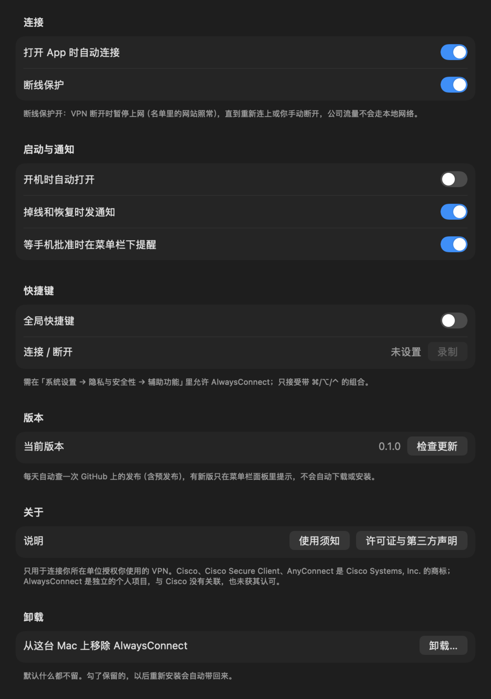
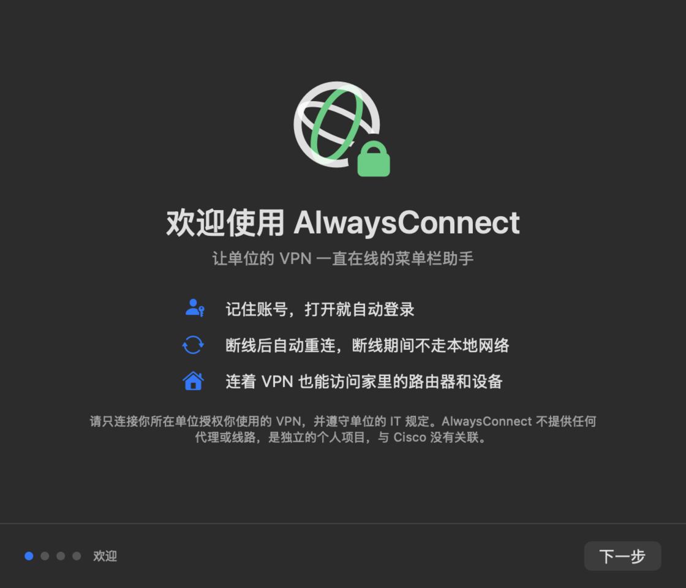

<h1 align="center">AlwaysConnect</h1>

<p align="center">
  <b>让单位授权的企业 VPN 一直在线、掉线不漏网的 macOS 菜单栏小工具</b><br>
  打开就连 · 掉线自己连回来 · 断开的那几秒不偷偷走本地网络 · 想直连的网站自己说了算
</p>

<p align="center">
  <a href="https://github.com/weiazm/always-connect/actions/workflows/ci.yml"></a>
  
  
  <a href="LICENSE"></a>
</p>

<p align="center">
  
</p>

---

## 这是什么

如果你每天要用 Cisco Secure Client（AnyConnect）连公司 VPN，AlwaysConnect 会替你盯着它：
记住账号，开机打开就连；网络一抖断了，它一直重连到连上为止；**断开的那段时间里，它把本地网络出口先关上**，
工作流量不会悄悄换成家里的 IP 发出去。连着 VPN 时，家里的路由器、NAS、打印机照样能用。

它住在菜单栏里，平时不打扰你，只有需要你在手机上确认登录时才会提醒。

> **定位：** AlwaysConnect 只是一个客户端，用来连接**你所在单位授权你使用**的企业 VPN。它不运营、不提供、
> 不内置任何 VPN 服务器、代理或网络线路，也不提供任何跨境访问服务；只连你自己填写的单位网关。
> 使用前请确认符合单位的 IT 规定，详见 [使用须知与责任声明](RESPONSIBLE-USE.md)。
> AlwaysConnect 是独立的个人项目，与 Cisco 没有任何关联（见文末商标声明）。

## 你可能正被这些事烦着

| 😩 以前 | 😌 用 AlwaysConnect 后 |
| --- | --- |
| 每天手动打开、输密码、点连接 | 打开 App 就自动登录，密码存在 macOS 钥匙串里 |
| Wi-Fi 一抖就断，断了也不会自己连回去 | 一直重连，直到连上为止，不需要你回到电脑前操作 |
| 断开的那一刻，流量自动改走本地网络，出口 IP 变了 | **断线保护**：断开期间先暂停上网，连回来再放行，逐秒测试没有漏出一个包 |
| 连着 VPN，家里 192.168.x.x 的设备打不开 | 自动识别你当前的局域网，路由器、NAS、打印机直连 |
| 不需要经过单位网络的网站也挤在 VPN 里，又慢又占单位带宽 | **按网站分流**：名单里的网站走本地网络，其余照常走单位 VPN |

## 亮点

- **🔁 断了自己连回来**：会话一丢就按退避间隔一直重连；只是短暂抖动的话，交给 Cisco 自己续上，不多打扰你。
- **📋 不用抄服务器地址**：自动读出 Cisco 里保存的服务器（名称和地址），默认选上次连的那台，Cisco 里有改动也跟着更新；密码存在钥匙串，没存过时提示你填。
- **🛡️ 断线不漏网**：断开期间用 macOS 自带的防火墙关掉本地出口，只留 DNS、局域网和 VPN 网关。连回来，或者你主动断开，才恢复正常上网。
- **🔀 按网站分流**：一个开关就能打开。名单由你自己写：网址（`example.com`）、开源域名清单（`geosite:apple`）、网段都行，改了立即生效，不用重连。分流只决定哪些流量不经过单位网络，不会为任何流量另找出口。
- **🏠 家里局域网照常用**：自动识别你现在连的网段，不写死 192.168，到了别人家、换了路由器也能用。
- **🆘 永远有退路**：面板上一直有「恢复网络」按钮，一键断开 VPN、清掉所有改动、回到直连。App 打不开时，还有一条终端命令能做到同样的事。
- **📱 只在需要时提醒**：要在手机上确认登录时，菜单栏下面会弹出一张小卡片，确认完自己收起，不弹窗轰炸。
- **🧹 干净卸载**：设置里点一下「卸载…」，后台服务、随附组件、日志、设置、钥匙串里的密码全部删掉，不留残留。
- **📦 开箱即用**：不用装 Homebrew，也不用装其他软件，连接组件已经打包在 App 里。占用很小，关掉的窗口立即释放内存。

## 截图

<table>
  <tr>
    <th>按网站分流：名单自己写</th>
    <th>通用设置</th>
  </tr>
  <tr>
    <td></td>
    <td></td>
  </tr>
  <tr>
    <th>第一次打开：三步向导</th>
    <th>菜单栏图标：一眼看出状态</th>
  </tr>
  <tr>
    <td></td>
    <td><br>
      未连接 · 连接中 / 等你确认 · 已连接 · 断线保护中</td>
  </tr>
</table>

## 两种连法，一个开关切换

| | 经 Cisco（默认） | 按网站分流 |
| --- | --- | --- |
| 谁来连 | 你电脑上已安装的 Cisco Secure Client，AlwaysConnect 负责登录、重连和断线保护 | AlwaysConnect 自己连（内置开源的 OpenConnect），使用钥匙串里单位发的证书，私钥不离开钥匙串 |
| 分流 | 按单位下发的规则走 | 名单里的网站走本地网络，其余走 VPN |
| 系统要求 | macOS 13 或更新，并装有 Cisco Secure Client | macOS 15 或更新 |

在面板上拨一下「按网站分流」就能切换。连着 VPN 时也能切，确认后会自动重新连接一次。

## 安装

> 目前 Releases 页面还没有公开发布的版本，可以先按页面下方「从源码构建」自己编一份。

在「终端」里粘贴下面这一行，回车：

```bash
curl -fsSL https://raw.githubusercontent.com/weiazm/always-connect/main/install.sh | bash
```

它会下载最新的发布版本、核对校验值、放进「应用程序」并打开。以后想更新，再执行一次同样的命令就行；
已经装着的旧版会先正常退出再替换。不需要另外解除系统拦截。

然后：

1. 如果你用经 Cisco 的方式连接，先退出 Cisco Secure Client 的窗口程序。它的后台服务保持运行即可。
2. 在 AlwaysConnect 里按向导走：安装后台服务（输一次电脑开机密码）→ 填账号密码（Cisco 里保存的服务器已自动导入，默认选上次连的那台；没有 Cisco 时手动添加）→ 连接 → 在手机上确认登录。
3. 系统问是否允许使用钥匙串里的密码和证书时，选「始终允许」。以后打开就会自动连上。

<details>
<summary><b>不想用命令行？手动下载安装</b></summary>

这是没有经过苹果公证的个人构建，用浏览器下载的 App 第一次打开会被系统拦下，提示「无法验证开发者」或「Apple 无法检查其是否包含恶意软件」。

1. 从 [Releases](https://github.com/weiazm/always-connect/releases) 下载 `AlwaysConnect-版本号-macos-arm64.zip`，解压后把 `AlwaysConnect.app` 拖进「应用程序」。
2. 双击打开一次，看到拦截提示后点「完成」或「取消」。
3. 打开「系统设置 → 隐私与安全性」，拉到「安全性」，点 AlwaysConnect 旁边的 **仍要打开**，输入开机密码，再点「打开」。只需要做一次。

macOS 15 起已经不能用「右键 → 打开」绕过拦截了，只能走上面第 3 步。也可以用终端一步解除：

```bash
xattr -dr com.apple.quarantine /Applications/AlwaysConnect.app
```

</details>

**和 Clash、sing-box、Surge 一起用：** 它们只开「系统代理」时可以同时用。开了 TUN 或增强模式（接管全部流量）会和任何 VPN 抢路由，
连之前请先关掉。AlwaysConnect 发现它们时会在面板上提示，但不会去改它们的设置。

**更新：** App 每天自动查一次 GitHub 上的发布（包括预发布）。有新版本时，菜单栏面板里会出现「有新版本」，点 **更新** 并确认，
它会下载、校验、退出旧版、换上新版并重新打开。VPN 会断开一下再自动连上，可能要在手机上再确认一次登录。
也可以在 设置 → 通用 → 版本 里点「检查更新」，或者在终端再执行一次上面的安装命令。

## 网络出问题时

- 在面板上点 **恢复网络**（输一次开机密码），会断开 VPN，清掉 AlwaysConnect 改过的路由、DNS 和防火墙设置，回到直连。
- App 打不开时，在终端执行下面这条命令，效果相同，而且不需要联网：
  ```bash
  sudo /Applications/AlwaysConnect.app/Contents/Resources/reset-network.sh
  ```

**卸载：** 设置 → 通用 → **卸载…**。Cisco Secure Client 不受影响。App 打不开时，在终端执行
`sudo bash /Applications/AlwaysConnect.app/Contents/Resources/uninstall.sh`（加上 `--dry-run` 只列出会删除什么，不真删）。

## 限制与须知

- **只支持 Cisco AnyConnect / Secure Client 类网关**，不支持其他品牌的 VPN。
- 手机上的登录确认没办法自动化，第一次连接和会话过期后都需要你确认一次。短暂掉线后很快重连上的话，通常不需要再确认。
- 经 Cisco 连接时，分流由公司规则决定，AlwaysConnect 不会绕过或修改 Cisco 的过滤规则。
- 按网站分流只按网站和网段分，不按应用分。
- 多用户 Mac 的后台服务归第一个连接它的登录用户；切换用户不会转交 VPN 控制权。其他用户需等原用户退出 App、后台服务空闲退出后再连接。
- 这是个人构建，没有苹果开发者签名与公证：用浏览器下载需要手动解除一次系统拦截（用上面的一行命令安装则不需要），后台服务要用管理员密码安装。
- 目前只在 Apple Silicon 上构建和测试过。
- 单位 VPN 怎么用由单位说了算：使用前请确认单位允许这类第三方客户端，尤其是"按网站分流"这种自建连接方式；
  并遵守所在地的法律法规。详见 [使用须知与责任声明](RESPONSIBLE-USE.md)。
- 发现安全问题请按 [SECURITY.md](SECURITY.md) 私下报告，不要开公开 Issue；反馈问题前请先把服务器地址、账号、内网地址换成示例值。

<details>
<summary><b>它是怎么工作的</b></summary>

```
菜单栏 App（你的账号权限，读钥匙串）
  ├─ 经 Cisco：调用 Cisco Secure Client 的命令行登录、监视状态，掉线后重新登录
  ├─ 按网站分流：用 App 内的证书转接，让打包的 OpenConnect 出示钥匙串里的证书
  └─ 后台服务（root，用的时候才启动）
        ├─ 断线保护：用 macOS 防火墙 pf，连着时放行，会话一丢就关上本地出口
        └─ 分流：本地 DNS 转发 + 按需加直连路由
```

长时间运行的逻辑（转发、规则匹配、DNS、重连决策）都用 Rust 写在 `core/` 里，Swift 只负责界面和系统接口。
完整设计和每一条实测结论见 [DESIGN.md](DESIGN.md)。
</details>

<details>
<summary><b>验证状态</b></summary>

| 项目 | 状态 |
| --- | --- |
| 真实网关连接（经 Cisco，手机确认登录） | ✅ 本机实测 |
| 断线期间不漏网 | ✅ 本机实测：逐秒探测零泄漏，DNS 与局域网可用 |
| 掉线后自动重新登录 | ✅ 本机实测：确认后 25 秒连回 |
| 按网站分流（App 内证书转接） | ✅ 本机实测：连通、掉线 8 秒自动连回且零泄漏、退出干净 |
| 编译、引擎整环、脚本分支、pf 规则解析、证书转接 | ✅ CI（Linux + macOS） |
| App 未运行时后台服务自行封网 | ⏳ 待实测 |

完整清单见 [docs/mac-proof-checklist.md](docs/mac-proof-checklist.md)。
</details>

<details>
<summary><b>从源码构建</b></summary>

构建机需要 Command Line Tools（不需要 Xcode）、Rust 和 Homebrew 的 `openconnect`。构建时会把 openconnect 和它的库打包进 App，
用户那边不需要再装。

```bash
scripts/dev-signing-identity.sh       # 第一次：建本机自签名身份（后台服务只接受同一证书签名的 App）
scripts/build-local.sh --tests        # 编译 + 组装 .local-build/AlwaysConnect.app + 跑本机断言
open .local-build/AlwaysConnect.app
scripts/install-app.sh                # 装到「应用程序」
```

有 Xcode 时也可以先 `xcodegen generate` 生成工程。各脚本的用途见 [AGENTS.md](AGENTS.md)。

文档：[DESIGN.md](DESIGN.md)（设计与实测结论）· [UI-DESIGN.md](UI-DESIGN.md)（界面）·
[HANDOVER.md](HANDOVER.md)（当前状态）· [AGENTS.md](AGENTS.md)（给贡献者和 AI 助手的约定）
</details>

## 许可证

本仓库代码采用 [MIT](LICENSE) 协议。App 内随附的第三方组件各按自己的许可证提供：OpenConnect 及其依赖库（LGPL 等，
可替换，对应源码由 `scripts/fetch-third-party-sources.sh` 下载）、链接进核心的 Rust 库（MIT）、分流用的
v2fly/domain-list-community 清单（MIT）与 APNIC 公开数据。完整清单、许可证正文和源码获取方式见
[THIRD_PARTY_NOTICES.md](THIRD_PARTY_NOTICES.md)；App 里在 设置 → 通用 → 关于 →「许可证与第三方声明」。

## 商标声明

Cisco、Cisco Secure Client、AnyConnect 是 Cisco Systems, Inc. 及/或其关联公司的商标或注册商标。
AlwaysConnect 是独立的个人项目，与 Cisco 没有任何关联，未获其认可、赞助或授权；本文提到这些名称只为说明兼容的软件。
AlwaysConnect 不包含、不分发、不修改 Cisco 的任何软件或图形，经 Cisco 连接时调用的是你电脑上已经安装的 Cisco Secure Client。
